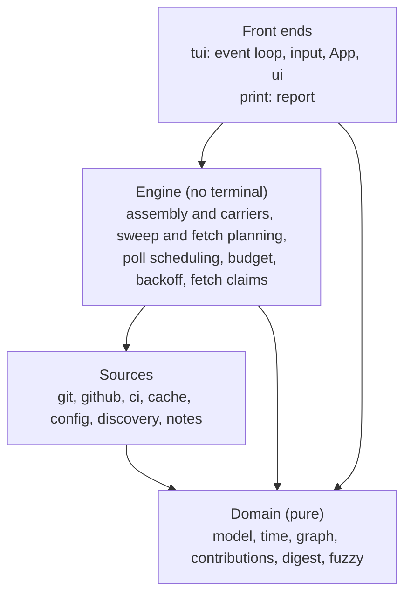

# fleetz architecture

The map of the code: what each module owns, which way dependencies point,
how data moves at runtime, who may change which state, and where the
structure has drifted from where it should be. It is the overview for
Andreas and the reference for every agent that plans or reviews a change.

**Status.** Sections 1 to 6 describe the code as it is, measured on `main`
at `8c66ad5` (2026-11-07). Section 7 is the target, accepted by Andreas on 2026-11-07
with every owner item in section 8.

**How to read it.** Everyone reads section 1. Agents then read the sections
their change touches, by heading, never the whole file. Domain rules live in
the design docs and `.claude/rules/`; this file links them and does not
repeat them (section 6).

## 1. Overview

fleetz is one Rust binary with two front ends over the same data:

- **TUI** (default): an async, channel-driven dashboard. The terminal opens
  on an empty `App`; background tasks load discovery, git and GitHub data
  and send results as `AppEvent`s; one event loop applies them and redraws.
- **Print mode** (`--print`, `src/report/`): repoz's one-shot text report
  rebuilt on fleetz's own discovery, git and GitHub code. It branches off
  in `main` before any terminal setup (`docs/repoz-print-design.md`, D1).


External systems: `git` as a subprocess (`git.rs`, one `Command::new("git")`
helper), GitHub over HTTPS with `reqwest` (GraphQL in `github.rs`, REST
Actions and the default branch tip's commit statuses, check runs and
status history in `ci.rs`) using the token from `gh auth token`, and the disk:
the API cache (`cache.rs`), the config and settings file (`config.rs`),
the saved time window (`window_state.rs`) and the notes walk (`notes.rs`).

## 2. Module map

Production lines exclude `#[cfg(test)]` code, and file counts exclude the
sibling test files a `#[cfg(test)] mod tests;` reads (FZ-104). "Effects" is
what the module does beyond computing: `proc` runs a program, `net` talks
HTTP, `fs` touches the disk, `term` draws or reads the terminal. The
`main.rs`, `app.rs` and `engine/` rows were re-measured for FZ-105, on its
base `e831dd1` with the move applied.

| Module | Lines | Owns | Effects |
|---|---|---|---|
| `main.rs` | 3,861 | Startup, the event loop, every input handler, task spawning, sweep and fetch planning, GitHub poll scheduling, editor and opener handoff | proc, term |
| `app.rs` | 6,350 | `App`: all TUI state (109 fields), the overlays, filters and query parsing, API budget and backoff, per-view caches for ci, notes, worktrees and digest | none (holds ratatui types) |
| `ui/` (18 files) | 12,318 | Drawing every view from `&App`; `detail.rs` alone is 3,984 | term |
| `git.rs` | 2,245 | Every git read and fetch, fetch outcomes and progress, `WorkKey`, the `changes` read (`changes`, `changed_file_diff`) | proc, fs |
| `report/` | 2,062 | Print mode: run, render byte for byte as repoz, golden parity harness | proc, fs |
| `github.rs` | 1,594 | The GraphQL query and its cost, the HTTP client, token lookup, failure kinds | net, proc |
| `ci.rs` | 1,537 | Workflow runs, jobs and log tails over REST, with ETags; the default branch tip's `TipStatus`, `TipChecks` and `StatusEvent` history, and `tip_verdict` over them | net |
| `engine/` (6 files) | 1,394 | View assembly (discovery passes, carriers, activity order, the startup fetch baseline), a row's status probe, the load (GitHub dataset or dirty mode), fetches under a claim (`FetchClaims`); progress leaves through `Sink`, which a front end's channel implements (FZ-105) | proc, fs, net |
| `model.rs` | 1,009 | `RepoStatus` and the row types the views draw | none |
| `discovery.rs` | 617 | Finding clones under roots and `$HOME`, clone matching (`Wanted`, `CheckoutRank`) | fs |
| `cache.rs` | 537 | The keyed on-disk API cache | fs |
| `graph.rs` | 472 | Commit graph lanes and glyphs | none |
| `contributions.rs` | 397 | The 53 by 7 contribution grid | none |
| `notes.rs` | 348 | Walking a repo for notes and markdown | fs |
| `digest.rs` | 334 | The slot digest model | none |
| `config.rs` | 290 | Config file, defaults, settings writes | fs |
| `time.rs` | 238 | Time windows and slots | none |
| `clipboard.rs` | 138 | Copying a hash to the system clipboard | proc |
| `cli.rs` | 116 | Flags (`clap`) | none |
| `fuzzy.rs` | 82 | Fuzzy match for search | none |
| `window_state.rs` | 48 | The remembered time window | fs |

Module docs (`//!`) exist on the newer modules but not on `main`, `app`,
`git`, `github`, `model`, `discovery`, `cache`, `config` or `ui/detail`:
the ones a newcomer most needs.

## 3. Dependencies as they are

Who uses whom, from `crate::` paths in production code. Arrows point from
user to used. Dotted arrows are the problem edges: five break the rules in
section 7 (`report` to `app`, `ci` and `config` to `app`, `model` to `git`
and `github`), and two are cycles inside one layer (`app` and `ui`, `cache`
and `github`). All but `report` to `app` close a cycle. `report` to `main`
left with FZ-105: print mode and the TUI both call the engine.

```mermaid
flowchart TB
  subgraph front[Front ends]
    main
    report
    ui
    app
  end
  subgraph eng[Engine]
    engine
  end
  subgraph io[Sources]
    git
    github
    ci
    cache
    config
    discovery
    notes
  end
  subgraph dom[Domain, pure]
    model
    contributions
    graph
    digest
    time
    fuzzy
  end
  main --> app & ui & report
  ui --> app
  app -.-> ui
  main --> engine
  report --> engine
  app --> engine
  engine --> io
  report -.->|FetchClaims, Icons| app
  ci -.->|Pace, RemoteKey,<br/>carrier_key| app
  config -.->|View, Icons,<br/>pane defaults| app
  app --> io
  main --> io
  model -.->|FetchOutcome, WorkKey,<br/>fetch helpers| git
  model -.->|GithubRepo| github
  git --> model
  github --> model
  github --> cache
  cache -.->|token_fingerprint,<br/>accept_response| github
  io --> dom
```

The edges that matter, with what crosses them:

| Edge | What crosses | Why it is a problem |
|---|---|---|
| `report` to `app` | `FetchClaims`, `Icons` | Print mode depends on TUI state types |
| `app` to `ui`, `app` to ratatui | `DetailHits`, `Divider`, `Loading`, colors, layout widths; `Rect`, `Line`, `Color` | State depends on drawing, so neither can change alone |
| `ci` to `app` | `Pace`, `RemoteKey`, `carrier_key` | A data source depends on TUI state |
| `config` to `app` | `View`, `Icons`, pane defaults | Settings depend on TUI state |
| `model` to `git`, `github` | Fetch outcome types and helpers, `GithubRepo` | The domain types depend on the sources that fill them, and the sources depend on them |
| `cache` to `github` | Token fingerprint, response check, hash | The cache and the fetcher depend on each other |

## 4. Runtime and data flow

**Startup** (`main.rs::main`): parse flags; print mode returns here; load
config; build an empty `App` and apply config and flags to it; install the
panic hook that restores the terminal; enter raw mode and the alternate
screen; open the channel; start the input thread and the tick task; remove
abandoned cache temp files; `spawn_load` the initial load; run the event
loop; restore the terminal; save pane sizes if `persist_pane_sizes` is set.

**Events.** Every background result reaches state through one channel and
one loop (`run_event_loop`), so state changes happen on one task in a
defined order. Sent by functions in `main.rs` unless noted.

| `AppEvent` | Sent by | Applied by |
|---|---|---|
| `Input` | `spawn_input_thread` | `handle_key`, `handle_mouse_input` and the handlers they call |
| `Tick` | `spawn_tick_task` | the loop: `App::on_tick`, status expiry, the watch sweep and GitHub poll when due |
| `YankFrame` | `next_event` (the loop's own wait) | the loop |
| `LoadingFrame` | `spawn_loading_task` | `on_loading_frame` |
| `Loaded` | `spawn_load`, `spawn_window_apply`, `spawn_memory_rebuild` | `apply_load_result` |
| `Progress` | `engine::assemble_view_held`, through `engine::Sink` | the loop |
| `RepoUpdated` | `spawn_sweep` | `apply_repo_updated` |
| `FetchProgress` | `engine::fetch_under_claim_capped`, through `engine::Sink` | the loop |
| `SweepDone` | `spawn_sweep` | `apply_sweep_done` |
| `Github` | `spawn_github_poll` | `apply_github_poll` |
| `Ci`, `CiDetail` | `spawn_ci_poll`, `spawn_ci_detail` | `App::apply_ci`, `App::apply_ci_detail` |
| `WorktreeLogRead` | `spawn_worktree_log` | `App::apply_worktree_log` |
| `NotesWalked` | `spawn_notes_walk` | `App::apply_notes_walk` |
| `NoteRead`, `NoteCommit` | `spawn_note_read` | `App::apply_note_read`, `apply_note_facts`, `apply_note_rendered`, `apply_note_commit` |
| `NoteRendered` | `spawn_note_render` | the loop |
| `ChangesRead` | `spawn_changes_read` | `App::apply_changes_read` |
| `ChangeDiff` | `spawn_change_diff` | `App::apply_change_diff` |
| `DigestLog` | `spawn_digest_log` | `App::apply_digest_log` |

**Stale answers.** A task's answer can land after a newer one. The guards:
the poll's `attempt` id (`GithubFreshness::begin_attempt`), fetch claim
tokens (`FetchClaims`), and per-view generations and cursors for notes,
worktrees, changes and ci. Contracts: `docs/freshness-contract.md`,
`docs/fetch-outcome-contract.md`.

## 5. State and who changes it

`App` is the whole TUI state: 109 fields, all `pub`. Grouped by concern:

| Group | Examples | Changed by |
|---|---|---|
| Fleet data | `repos`, `dataset`, `github_meta`, `not_in_last_poll`, `window` | load, sweep and poll handlers in `main.rs` |
| GitHub sync | `github_freshness`, `api_budget`, `github_backoff`, poll timing fields | poll scheduling and apply in `main.rs`, `App` methods |
| Local fetch | `fetches_in_flight`, `fetch_backoff`, `manual_fetches`, refresh fields | sweep and fetch planning in `main.rs` |
| Navigation and view | `view`, `overlay`, `selected`, `focused_panel`, `history_view`, scrolls, pane percentages | input handlers in `main.rs`, `App` methods |
| Per-view caches | `ci` (each repo's `CiTip` with it), `notes`, `note_body`, `worktree_logs`, `digest_logs` | `App::apply_*` |
| Render feedback | 18 `Cell` and `RefCell` fields such as `detail_hits`, `list_hits`, `reader_width` | `ui::render`, while drawing |

As it is, any code holding `&mut App` may change any field, and `ui`
changes some through `Cell` while it holds only `&App` (22 writes, 18 of
them in `ui/detail.rs`). What keeps the
behavior right today is the invariants in `.claude/rules/` and the tests,
not the types. `ApiBudget`, `GithubBackoff`, `FetchClaims` (in `engine`
since FZ-105) and
`GithubFreshness` are the exception: concerns with their own type, methods
and tests, and the pattern section 7 builds on.

## 6. Where the domain rules live

| Area | Rules and contracts |
|---|---|
| Discovery, carriers, clone matching | `.claude/rules/discovery.md`, `docs/repository-identity-design.md` |
| GitHub fetch, budget, cache | `.claude/rules/github.md`, `docs/api-budget-design.md`, `docs/coverage-cache-design.md`, `docs/freshness-contract.md` |
| Sweep and cache invalidation | `docs/cache-invalidation-design.md`, `docs/fetch-outcome-contract.md` |
| Layout, render order, status vocabulary | `.claude/rules/ui.md` |
| Commit list and graph | `.claude/rules/git-graph.md` |
| Print mode | `docs/repoz-print-design.md` |

## 7. Target shape (accepted 2026-11-07)

Four layers. Dependencies point down only.



Rules:

- **A1. Down only.** No module imports from a layer above it. That removes
  every dotted edge in section 3.
- **A2. No terminal below the front ends.** `ratatui` and `crossterm`
  appear only in `ui/`, the event loop and `App`'s view state.
- **A3. One engine, two front ends.** The assembly that `report` borrows
  from `main.rs` today moves into the engine, and print mode and the TUI
  both call it. Print mode never imports the TUI.
- **A4. State has owners.** A concern with rules of its own gets its own
  type that owns its fields, the way `ApiBudget` does, and `App` holds
  those types instead of loose fields. Render feedback is one declared
  struct, not cells scattered across `App`.
- **A5. The engine is a module now, a crate later.** Inside the one crate,
  as print mode's D1 decided, but shaped so it can become the UI-free
  `fleetz-core` that epoz needs without a rewrite.
- **A6. Rules are checked, not remembered.** A script fails when an import
  breaks A1 or A2, in the spirit of Relay's gates in tools rather than
  prose. The check is the unit test `architecture::layers_hold_but_for_the_allowlist`
  (`src/architecture.rs`), which also fails on A3 and on an allowlist entry
  that no longer occurs.

What this means for the refactor: the seams come from these layers, not
from the order functions sit in today's files. The tickets, their order and
the gate are in `docs/module-split-design.md`.

## 8. Owner items

- **O1** Accepted 2026-11-07: the four layers, with A1 to A5.
- **O2** Accepted 2026-11-07: the engine is an in-crate module now (keeps
  D1); the `fleetz-core` crate split waits until epoz needs it.
- **O3** Accepted 2026-11-07: A6 is a unit test in the normal suite, so CI
  runs it through `cargo test` with no CI change. Today's violations start
  on an allowlist that may only shrink. It is the first code ticket
  (`docs/module-split-design.md`, L1).
- **O4** Accepted 2026-11-07: an architect role keeps this file current,
  run by the lead at set triggers and by Andreas on demand, never as a
  standing agent.

## 9. Keeping this file true

- A ticket that adds a module, moves a responsibility, adds an `AppEvent`
  or changes a dependency edge updates the matching section here in the
  same ticket.
- The numbers in sections 2 and 3 are measured by script, not by hand;
  rerun them at each milestone and after each split.
- When this file and the code disagree, the code is the fact and this file
  is the bug.
