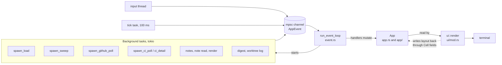
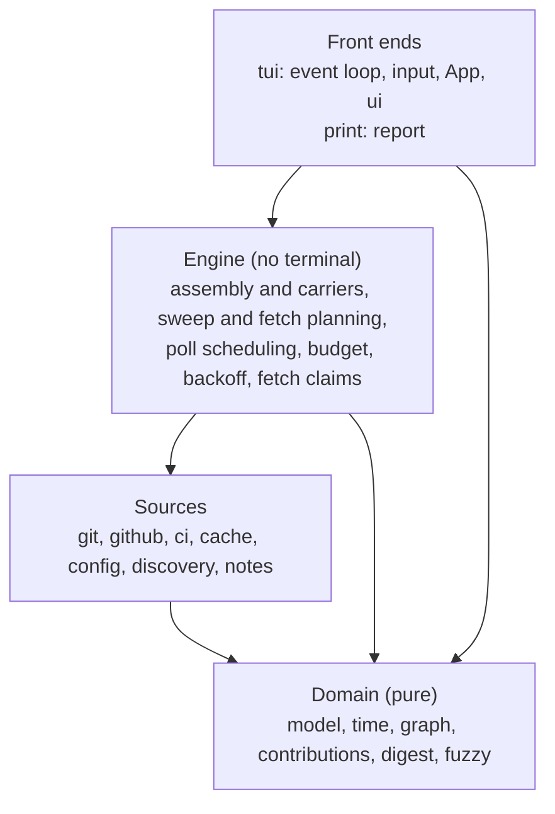

# fleetz architecture

The map of the code: what each module owns, which way dependencies point,
how data moves at runtime, who may change which state, and where the
structure has drifted from where it should be. It is the overview for
Andreas and the reference for every agent that plans or reviews a change.

**Status.** Sections 1 to 6 describe the code as it is, measured on `main`
at `5d2e7f6` (2026-11-19, after the app-split batch FZ-113 to FZ-124 of
`docs/app-split-design.md`). Section 7 is the target, accepted by Andreas
on 2026-11-07 with every owner item in section 8.

**How to read it.** Everyone reads section 1. Agents then read the sections
their change touches, by heading, never the whole file. Domain rules live in
the design docs and `.claude/rules/`; this file links them and does not
repeat them (section 6).

## 1. Overview

fleetz is one Rust binary with two front ends over the same data:

- **TUI** (default): an async, channel-driven dashboard. The terminal opens
  on an empty `App`; background tasks load discovery, git and GitHub data
  and send results as `AppEvent`s; one event loop applies them and redraws.
- **Print mode** (`--print`, `src/report/`): repoz's one-shot text report
  rebuilt on fleetz's own discovery, git and GitHub code. It branches off
  in `main` before any terminal setup (`docs/repoz-print-design.md`, D1).



External systems: `git` as a subprocess (`git.rs`, one `Command::new("git")`
helper), GitHub over HTTPS with `reqwest` (GraphQL in `github.rs`, REST
Actions and the default branch tip's commit statuses, check runs and
status history in `ci.rs`) using the token from `gh auth token`, and the disk:
the API cache (`cache.rs`), the config and settings file (`config.rs`),
the saved time window (`window_state.rs`) and the notes walk (`notes.rs`).

## 2. Module map

Production lines are a file's lines with every `#[cfg(test)]` item removed
(the attribute and the item it governs; blank and comment lines count),
and the files a `#[cfg(test)] mod x;` reads are left out entirely: the
sibling `tests.rs` files (FZ-104), `discovery/repoz_parity.rs` (171
lines), `report/parity.rs` (the golden parity harness, 767 lines, counted
in the `report/` row until this survey applied the rule to it) and
`src/architecture.rs` (the layer test, 477 lines). "Effects" is what the
module does beyond computing: `proc` runs a program, `net` talks HTTP,
`fs` touches the disk, `term` draws or reads the terminal. Every row below
was measured on `5d2e7f6` (2026-11-19) by one script over the whole tree;
rows are in size order, a directory row by the sum of its files.

| Module | Lines | Owns | Effects |
|---|---|---|---|
| `ui/` (28 files) | 13,408 | Drawing every view from `&App`; `detail/` is ten files by pane since FZ-108, 4,755 together: `pane.rs` 1,032, `notes.rs` 612, `mod.rs` 530 (the entry `render` and the helpers the panes share), `commits.rs` 501, `header.rs` 482, `list.rs` 403, `inspector.rs` 379, `worktrees.rs` 355, `changes.rs` 301, `layout.rs` 160; then `mod.rs` 1,541, `markdown.rs` 1,245, `ci.rs` 1,072, `digest.rs` 701, and the other 14 files 4,094 together (`contributions.rs` 555, `highlight.rs` 472, `footer.rs` 472, `todo.rs` 451, `badges.rs` 443, `help.rs` 368, `colors.rs` 305, `intro.rs` 261, `compact.rs` 213, `branches.rs` 213, `grips.rs` 113, `settings.rs` 112, `timewindow.rs` 91, `scroll.rs` 25) | term |
| `app/` (13 files) | 5,689 | `App`, the TUI state, split by concern (`docs/app-split-design.md`, FZ-110 to FZ-124). `app.rs` 685: the struct (52 fields, section 5), `new`, the tick, fetch expiry and progress, `visible_repos` and the search, groups, help, status and `summary`. Then one file per concern, each holding the owner type where there is one, its types (re-exported from `app`) and the `App` methods on it: `ci.rs` 1,004 (`CiView`, FZ-118: polling, landing and reading the ci view), `overlays.rs` 616 (the overlays and settings rows, FZ-110), `selection.rs` 541 (FZ-124: the repo cursor, the detail cursor and its scroll, the graph cursor, the history view cycle), `yank.rs` 454 (`YankState`, `YankKind`, `YankFlash` with its timing constants, FZ-123), `notes.rs` 452 (`NotesView` and the reader, FZ-119), `digest.rs` 439 (`DigestView`, `ListHits`, `ListRow`, `HOVER_DWELL`, FZ-121: the front end's state over the domain's `digest.rs`), `panes.rs` 373 (FZ-124: the resize bounds, folds, resize, pane scroll and focus), `contrib.rs` 329 (`ContribStrip`, `ContributionsMode`, `CellSize`, FZ-122: the front end's state over the domain's `contributions.rs`), `changes.rs` 292 (`ChangesView`, FZ-120), `query.rs` 210 (the filters and query parsing, FZ-110), `worktrees.rs` 159 (`WorktreesView`, FZ-120), `feedback.rs` 135 (`RenderFeedback`, the 18 render cells as `drawn`, FZ-117) | none (holds ratatui types at four sites, section 3) |
| `engine/` (7 files) | 2,832 | `github_sync.rs` 851: the GitHub sync (FZ-113), `GithubSync` over `GithubFreshness`, `ApiBudget`, `GithubBackoff`, the jitter, the poll's in-flight lock and push flag, and the decisions on them (`poll_due`, `effective_interval`, `limit_until`, `pace`), taking a `PollContext` the front end builds; `fetch.rs` 746: the local fetch (FZ-116), `FetchState` over the sweep lock, the refresh flags, `FetchBackoff`, the cap, `FetchClaims` and `FetchTally`, and the decisions on them (`begin_sweep`, `plan`, `held`, `claim`, `refresh_phase`), taking the size-held set and the watch interval the front end supplies; fetches under a claim and the types the sweep plans with (`SweepTarget`, `FetchAsk`, `SweepFetchPlan`, `FetchReport`, FZ-106); `assembly.rs` 559: view assembly (discovery passes, carriers, activity order, the startup fetch baseline); `status.rs` 313: a row's status probe; `load.rs` 191: the load (GitHub dataset or dirty mode); `carriers.rs` 126; `mod.rs` 46: `Sink`, which a front end's channel implements (FZ-105) | proc, fs, net |
| `git.rs` | 2,444 | Every git read and fetch, reading a fetch's outcome and progress and a checkout's `WorkKey` (the types live in `model`), the `changes` read (`changes`, `changed_file_diff`), the note body read | proc, fs |
| `github.rs` | 1,559 | The GraphQL query and its cost, the HTTP client, token lookup, failure kinds; parsing the payload into `model::GithubRepo` | net, proc |
| `ci.rs` | 1,538 | Workflow runs, jobs and log tails over REST, with ETags; the default branch tip's `TipStatus`, `TipChecks` and `StatusEvent` history, and `tip_verdict` over them | net |
| `report/` (2 files) | 1,292 | Print mode: run (`mod.rs` 910), render byte for byte as repoz (`render.rs` 382); the golden parity harness `parity.rs` is test-only (`#[cfg(test)] pub mod parity;`) and left out as the rule above says | proc, fs |
| `input.rs` | 1,080 | Every input handler: keys, mouse, the overlays' keys, the settings overlay, `r`, `R` and `f` | proc, term |
| `model.rs` | 953 | `RepoStatus` and the row types the views draw; the types the sources fill (`WorkKey`, `GithubRepo`), re-exporting the fetch record from `model/fetch.rs`; remote identity (`identity_key`, `RemoteRef`, `RemoteKey`, `carrier_key`) | none |
| `event.rs` | 633 | `AppEvent`, `LoadResult`, the input thread, the tick and loading tasks, the event loop (`run_event_loop`) | term |
| `poll.rs` | 611 | Starting and applying the GitHub poll (its scheduling is `engine::GithubSync` since FZ-113), the account rebuild, the CI tick, spawning the background reads (CI, worktree log, notes, changes, digest) | none |
| `discovery.rs` | 611 | Finding clones under roots and `$HOME`, clone matching (`Wanted`, `CheckoutRank`) | fs |
| `cache.rs` | 525 | The keyed on-disk API cache | fs |
| `graph.rs` | 471 | Commit graph lanes and glyphs | none |
| `sweep.rs` | 465 | The local sweep: targets, the size-held set and the clock handed to `FetchState::plan`, spawning it, landing a repo's result, the activity order | none |
| `notes.rs` | 443 | Walking a repo for notes and markdown, the capped body read | fs |
| `contributions.rs` | 431 | The 53 by 7 contribution grid | none |
| `load.rs` | 366 | Spawning the load, the window apply and the memory rebuild; applying a `LoadResult` | none |
| `config.rs` | 349 | Config file, defaults, settings writes; the values its keys select (`View` and `initial_view`, `Icons`, the pane defaults) | fs |
| `handoff.rs` | 347 | Editor, opener, `gh` and lazygit handoffs: suspending and reclaiming the terminal | proc, fs, term |
| `digest.rs` | 333 | The slot digest model | none |
| `time.rs` | 249 | Time windows and slots; the poll `Pace` | none |
| `model/fetch.rs` | 249 | The record of a fetch (FZ-111): `FetchFailureKind`, `FetchFailure`, `FetchOutcome`, `FetchPhase`, `FetchProgress`, `FetchFacts` and `SizeHold` | none |
| `main.rs` | 216 | Startup and teardown (`main`), the `mod` lines | term |
| `clipboard.rs` | 137 | Copying a hash to the system clipboard | proc |
| `cli.rs` | 115 | Flags (`clap`) | none |
| `fuzzy.rs` | 81 | Fuzzy match for search | none |
| `window_state.rs` | 44 | The remembered time window | fs |

Module docs (`//!`) exist on 35 of the 74 production files: `engine/`
(7), `report/` (2), the ten `app/` files the split made (`ci`, `notes`,
`changes`, `worktrees`, `digest`, `contrib`, `yank`, `panes`, `selection`,
`feedback`), `ci`, `notes`, `graph`, `digest`, `contributions`, `fuzzy`,
`clipboard` and nine `ui/` files (`ci`, `contributions`, `digest`,
`grips`, `highlight`, `intro`, `markdown`, `scroll`, `todo`). The other
39 have none: `main` and its six siblings (`event`, `input`, `handoff`,
`load`, `poll`, `sweep`), `app`, `app/overlays`, `app/query`, `git`,
`github`, `model`, `model/fetch`, `discovery`, `cache`, `config`, `cli`,
`time`, `window_state`, and 19 `ui/` files (`mod`, the ten `detail/`
files, `badges`, `branches`, `colors`, `compact`, `footer`, `help`,
`settings`, `timewindow`). The first twelve are the ones a newcomer most
needs; `docs/app-split-design.md` "Readability at the end" asks for a
three-line `//!` on every file.

**Structure notes** (measured drift from the limits in `CLAUDE.md`: about
1200 production lines per file, 150 per function; the seams are tickets in
`docs/module-split-design.md`):

- Files over the limit: `git.rs` 2,444 (G1), `github.rs` 1,559,
  `ui/mod.rs` 1,541, `ci.rs` 1,538, `ui/markdown.rs` 1,245 (the last four
  are not planned: revisit if they grow). Within 200 of it: `input.rs`
  1,080, `ui/ci.rs` 1,072, `ui/detail/pane.rs` 1,032 and `app/ci.rs` 1,004
  (the split design's estimate for it was 650). `ui/detail.rs` (U1,
  FZ-108), `main.rs` (F1, FZ-109) and `app.rs` (A1, FZ-110 to FZ-124) are
  split; `app.rs` is 685 against the design's 800 target, and every
  `app/*.rs` but `ci.rs` and `overlays.rs` (616) is under the design's 600
  estimate.
- `model.rs` is split (FZ-111): the fetch record moved to
  `model/fetch.rs`, which `model` re-exports, so every `model::` path and
  the `git` re-export keep resolving. `WorkKey` stays in `model.rs`, beside
  the `RepoStatus` field it fills. A pure move inside the domain layer; no
  edge changes.
- Functions over 200 lines, counted from the `fn` line to its closing
  brace (S1, one ticket each; F1 and U1 are done, so each is unblocked):
  `ui::detail::pane::render_detail_pane` 700,
  `input::handle_normal_input` 372, `engine::assembly::assemble_view_held`
  256, `event::run_event_loop` 236 and `ui::detail::header::header_lines`
  222. Four more sit between 150 and 200: `ui::branches::render` 193,
  `ui::detail::commits::graph_list_lines` 184,
  `ui::detail::inspector::render_inspector` 175, `main::main` 155.

## 3. Dependencies as they are

Who uses whom, from `crate::` paths in production code (`main.rs` is the
crate root and names modules bare, so its edges come from `<module>::`
paths). Arrows point from user to used. No edge breaks the rules in
section 7: the layer test's allowlist is empty since FZ-107 (`report` to
`main` left with FZ-105, `report` to `app` with D1's `Icons`, `ci` and
`config` to `app` and `model` to `git` and `github` with FZ-107, by moving
the shared types down). What remains is one cycle inside one layer,
drawn dotted, which A1 does not forbid:

- `app` and `ui`, both front ends. `app` names `ui` at 11 production
  sites (`crate::ui` paths outside comments), by file and symbol so a move
  does not stale them: three field types, `RenderFeedback::detail_hits`
  (`src/app/feedback.rs`, `ui::detail::DetailHits`), `App::loading_field`
  (`src/app.rs`, `ui::intro::Loading`) and `App::dragging` (`src/app.rs`,
  `ui::Divider`); `ui::colors` in `YankState::cell_bg` (`src/app/yank.rs`);
  `ui::ci::run_status` in `App::claim_ci_details` (`src/app/ci.rs`) and
  `ui::ci::shown_log` in `App::ci_shown_text` (`src/app/yank.rs`);
  `ui::detail::repo_list_width` in `App::resize_repo_list`
  (`src/app/panes.rs`); `ui::detail::RECENT_COMMIT_COUNT` in
  `App::selected_commit_count` and `ui::detail::DetailClick` in
  `App::click_detail` (both `src/app/selection.rs`);
  `ui::contributions::weeks_dragged` and `cols_for_weeks` in
  `App::pan_contributions` (`src/app/contrib.rs`). `app/` holds `ratatui`
  types at four sites: `CiLogWrap::lines` (`app/ci.rs`),
  `RenderedNote::lines` (`app/notes.rs`), `ListHits::area`
  (`app/digest.rs`) and the `Color` that `YankState::cell_bg` returns
  (`app/yank.rs`); `app.rs` itself holds none. `ui` names `app` in 23 of
  its 28 files (118 lines with `crate::app` or `app::` outside comments:
  `footer.rs` 22, `mod.rs` 17, `detail/list.rs` 16, `compact.rs` 13). A4
  is met for the concerns `docs/app-split-design.md` named (section 5);
  the cycle stays until R2 (FZ-125) moves `DetailHits` and `DetailClick`
  to the `app` side and O-B rules on its direction.

The `cache` and `github` cycle ended with FZ-112: `fnv1a_64` lives in
`cache`, and `github.rs` takes `cache::ApiCache` and `cache::KeyedCache`
at 11 sites, so the edge runs one way.

Sideways edges inside a layer, allowed and worth knowing: `ci` to `git`
and `github`; `git` to `notes` (the note body read, FZ-60); `notes` to
`discovery` (`PRUNE_DIRS`); `model` to `contributions` and `graph`;
`digest` to `model` and `time`.

```mermaid
flowchart TB
  subgraph front[Front ends]
    main
    report
    ui
    app
  end
  subgraph eng[Engine]
    engine
  end
  subgraph io[Sources]
    git
    github
    ci
    cache
    config
    discovery
    notes
  end
  subgraph dom[Domain, pure]
    model
    contributions
    graph
    digest
    time
    fuzzy
  end
  main --> app & ui & report
  ui --> app
  app -.-> ui
  main --> engine
  report --> engine
  app --> engine
  engine --> io
  app --> io
  main --> io
  report --> io
  git --> model
  github --> model
  github --> cache
  io --> dom
```

The edges that matter, with what crosses them:

| Edge | What crosses | Why it is a problem |
|---|---|---|
| `app` to `ui`, `app` to ratatui | `DetailHits`, `DetailClick`, `Divider`, `Loading`, colors, `run_status`, `shown_log`, `repo_list_width`, `RECENT_COMMIT_COUNT`, `weeks_dragged`, `cols_for_weeks`; `Rect`, `Line`, `Color` | State depends on drawing, so neither can change alone |

## 4. Runtime and data flow

**Startup** (`main.rs::main`): parse flags; print mode returns here; load
config; build an empty `App` and apply config and flags to it; install the
panic hook that restores the terminal; enter raw mode and the alternate
screen; open the channel; start the input thread and the tick task; remove
abandoned cache temp files; `spawn_load` the initial load; run the event
loop; restore the terminal; save pane sizes if `persist_pane_sizes` is set.

**Events.** Every background result reaches state through one channel and
one loop (`run_event_loop`), so state changes happen on one task in a
defined order. Sent by functions in `event.rs`, `load.rs`, `sweep.rs` and
`poll.rs` unless noted.

| `AppEvent` | Sent by | Applied by |
|---|---|---|
| `Input` | `event::spawn_input_thread` | `handle_key`, `handle_mouse_input` and the handlers they call |
| `Tick` | `event::spawn_tick_task` | the loop: `App::on_tick`, status expiry, the watch sweep when due, and the GitHub poll when `GithubSync::poll_due` says so over `App::poll_context` |
| `YankFrame` | `event::next_event` (the loop's own wait) | the loop |
| `LoadingFrame` | `event::spawn_loading_task` | `on_loading_frame` |
| `Loaded` | `load::spawn_load`, `spawn_window_apply`, `spawn_memory_rebuild` | `apply_load_result` |
| `Progress` | `engine::assemble_view_held`, through `engine::Sink` | the loop |
| `RepoUpdated` | `sweep::spawn_sweep` | `apply_repo_updated` |
| `FetchProgress` | `engine::fetch_under_claim_capped`, through `engine::Sink` | `App::apply_fetch_progress` |
| `SweepDone` | `sweep::spawn_sweep` | `apply_sweep_done` |
| `Github` | `poll::spawn_github_poll` | `apply_github_poll` |
| `Ci`, `CiDetail` | `poll::spawn_ci_poll`, `spawn_ci_detail` | `App::apply_ci`, `App::apply_ci_detail` |
| `WorktreeLogRead` | `poll::spawn_worktree_log` | `App::apply_worktree_log` |
| `NotesWalked` | `poll::spawn_notes_walk` | `App::apply_notes_walk` |
| `NoteRead`, `NoteCommit` | `poll::spawn_note_read` | `App::apply_note_read`, `apply_note_facts`, `apply_note_rendered`, `apply_note_commit` |
| `NoteRendered` | `poll::spawn_note_render` | `App::apply_note_rendered` |
| `ChangesRead` | `poll::spawn_changes_read` | `App::apply_changes_read` |
| `ChangeDiff` | `poll::spawn_change_diff` | `App::apply_change_diff` |
| `DigestLog` | `poll::spawn_digest_log` | `App::apply_digest_log` |

The `App::apply_*` handlers live with their view since the split: `apply_ci`
and `apply_ci_detail` in `app/ci.rs`, the four note handlers and
`apply_notes_walk` in `app/notes.rs`, `apply_changes_read` and
`apply_change_diff` in `app/changes.rs`, `apply_worktree_log` in
`app/worktrees.rs`, `apply_digest_log` in `app/digest.rs`;
`apply_fetch_progress` stays in `app.rs`.

**Stale answers.** A task's answer can land after a newer one. The guards:
the poll's `attempt` id (`GithubFreshness::begin_attempt`), fetch claim
tokens (`FetchClaims`), and per-view generations and cursors for notes,
worktrees, changes and ci. Contracts: `docs/freshness-contract.md`,
`docs/fetch-outcome-contract.md`.

## 5. State and who changes it

`App` is the whole TUI state: 52 fields. Ten are owner types, `pub(crate)`
on `App`: `github` and `fetch` (in `engine`, their fields private, reached
through verbs and queries) and `drawn`, `ci`, `notes`, `changes`,
`worktrees`, `digest`, `contrib` and `yank` (in `app/`, their fields
`pub(crate)` under O-E of `docs/app-split-design.md`, to tighten to
`pub(super)` after R2). The other 42 are plain `pub` fields the design
keeps plain: fleet data, navigation and layout, search, status and loop,
the settings copies. Grouped by concern (the plain fields by name):

| Group | Fields | Changed by |
|---|---|---|
| Fleet data | `repos`, `dataset`, `github_meta`, `not_in_last_poll`, `window`, `dirty_mode`, `load_error`, `loading`, `apply_progress`, `account_rebuild_due`, `last_refreshed`, `group_names`, `active_group` (plain) | load, sweep and poll handlers in `load.rs`, `sweep.rs` and `poll.rs` |
| GitHub sync | `github` (`engine::GithubSync`, FZ-113): freshness, budget, backoff, jitter, interval and cost, in-flight lock, push flag, all private | its verbs only, called from `poll.rs`, `load.rs`, `event.rs`, `sweep.rs` and `input.rs`; `ui` reads its queries |
| Local fetch | `fetch` (`engine::FetchState`, FZ-116): sweep lock, refresh flags, timeout holds, cap, fetch claims, keypress tally, all private | its verbs only, called from `sweep.rs`, `poll.rs`, `load.rs`, `event.rs`, `input.rs` and `main.rs`; `plan` takes the size-held set and the watch interval (`refresh_interval` stays a plain `App` field, a settings copy); `ui` reads `refresh_phase` and `is_refreshing` |
| Navigation and view | `view`, `overlay`, `selected`, `focused_panel`, `history_view`, `detail_selections`, `inspector_scroll`, `graph_cursor`, `repo_list_pct`, `inspector_pct`, `inspector_folded`, `contributions_folded`, `dragging`, `view_overridden`, `expand_remote_branches`, `show_pr_detail`, `brackets_cycling_views` (plain) | input handlers in `input.rs`; `App` methods in `app/panes.rs` (layout, folds, focus) and `app/selection.rs` (cursors, detail scroll, history view) since FZ-124; the overlays and settings rows in `app/overlays.rs` |
| Search, status and loop | `search_query`, `search_active`, `status_message`, `header`, `should_quit`, `needs_redraw`, `spinner_frame`, `blink_on`, `loading_field`, and the settings copies `watch_mode`, `refresh_interval`, `persist_pane_sizes` (plain) | `App` methods in `app.rs` (search, status, tick), `input.rs` and the loop; the settings overlay writes the copies live |
| Per-view caches | `ci` (`app::ci::CiView`, FZ-118: `ci.states`, each repo's `CiTip` with it, `ci.budget`, the cursor, the inspector's body, scrolls, job mark and inspected run, all `pub(crate)` per O-E), `notes` (`app::notes::NotesView`, FZ-119: `notes.states`, `notes.generation`, `notes.all_markdown`, the cursor, `notes.body`, `notes.todoz_fallback_said`, `notes.reader_scroll` and `notes.reader_raw`, all `pub(crate)` per O-E), `changes` (`app::changes::ChangesView`, FZ-120: `changes.states`, `changes.generation`, `changes.base`, the cursor and `changes.diff`, all `pub(crate)` per O-E), `worktrees` (`app::worktrees::WorktreesView`, FZ-120: `worktrees.logs`, `worktrees.generation` and the cursor, all `pub(crate)` per O-E), `digest` (`app::digest::DigestView`, FZ-121: `digest.logs`, `digest.window`, `digest.selected`, `digest.list_stop`, `digest.work_hours` and `digest.hover_pending`, all `pub(crate)` per O-E), `contrib` (`app::contrib::ContribStrip`, FZ-122: `contrib.mode`, `contrib.calendar`, `contrib.author`, `contrib.cell`, the day cursor and `contrib.drag`, all `pub(crate)` per O-E; the scroll and visible width stay in `drawn`, the fold flag on `App`) | `App::apply_*` |
| Yank | `yank` (`app::yank::YankState`, FZ-123): `yank.pending`, the chord's armed flag, and `yank.flash`, the copy flash (`YankFlash`), both `pub(crate)` per O-E | `press_yank_key` and `yank` on `App`; `event.rs` ends and ticks the flash, `input.rs` clears the chord; `ui::paint_yank_flash` reads it |
| Render feedback | `drawn` (`app::feedback::RenderFeedback`, FZ-117): 18 `Cell` and `RefCell` fields such as `app.drawn.detail_hits`, `app.drawn.list_hits`, `app.drawn.reader_width`, all `pub(crate)` | `ui::render`, while drawing, through `&App`; `App` methods in `app/contrib.rs`, `app/selection.rs`, `app/panes.rs`, `app/notes.rs`, `app/digest.rs` and `app/ci.rs` read them and write six of them (36 sites in 23 methods, counted by enclosing `fn`; two of the methods take `&self`: `set_detail_scroll`, `scroll_cursor_into_view`); `input.rs` reads `contrib_scroll`, `detail_hits` and `main_area_width` |

As it is, any code holding `&mut App` may change any plain field, and
`ui` changes `drawn` through `Cell` while it holds only `&App` (26 `.set(`
and `.borrow_mut(` sites on `app.drawn`, 19 of them in `ui/detail/`: 8 in
`pane.rs`, 4 in `inspector.rs`, 2 each in `list.rs` and `notes.rs`, 1
each in `changes.rs`, `mod.rs` and `worktrees.rs`; then two each in
`contributions.rs`, `digest.rs` and `footer.rs` and one in `ui/mod.rs`;
`ui/detail/pane.rs` also calls `App::set_detail_scroll(&self)` twice, the
renderer's clamp of the scroll the user asked for). R2 (FZ-125) ends that:
the loop owns the value and `render` takes `&mut RenderFeedback`. What
keeps the behavior right today for the 42 plain fields is the invariants
in `.claude/rules/` and the tests, not the types. The ten owner types are
the pattern section 7 builds on: `GithubSync` (in `engine` since FZ-113,
owning `GithubFreshness`, `ApiBudget` and `GithubBackoff`) and
`FetchState` (in `engine` since FZ-116, owning `FetchBackoff`,
`FetchClaims` and `FetchTally`) with private fields and verbs, and the
eight `app/` types with `pub(crate)` fields and their `impl App` blocks
moved unchanged (D5). `ApiBudget`, `GithubBackoff` and `GithubFreshness`
are still also used directly by `CiView` (`app/ci.rs`, FZ-118):
`ci.budget` is its own `ApiBudget` and shares `GithubSync`'s jitter stream
through `jitter_mut()`.

## 6. Where the domain rules live

| Area | Rules and contracts |
|---|---|
| Discovery, carriers, clone matching | `.claude/rules/discovery.md`, `docs/repository-identity-design.md` |
| GitHub fetch, budget, cache | `.claude/rules/github.md`, `docs/api-budget-design.md`, `docs/coverage-cache-design.md`, `docs/freshness-contract.md` |
| Sweep and cache invalidation | `docs/cache-invalidation-design.md`, `docs/fetch-outcome-contract.md` |
| Layout, render order, status vocabulary | `.claude/rules/ui.md` |
| Commit list and graph | `.claude/rules/git-graph.md` |
| Print mode | `docs/repoz-print-design.md` |

## 7. Target shape (accepted 2026-11-07)

Four layers. Dependencies point down only.



Rules:

- **A1. Down only.** No module imports from a layer above it. It holds
  since FZ-107 (the allowlist is empty); the dotted edge left in
  section 3 is a cycle inside one layer, which A1 permits and A4 (`app`
  and `ui`) removes; the `cache` and `github` cycle ended in FZ-112.
- **A2. No terminal below the front ends.** `ratatui` and `crossterm`
  appear only in `ui/`, the event loop and `App`'s view state.
- **A3. One engine, two front ends.** The assembly that `report` borrows
  from `main.rs` today moves into the engine, and print mode and the TUI
  both call it. Print mode never imports the TUI.
- **A4. State has owners.** A concern with rules of its own gets its own
  type that owns its fields, the way `ApiBudget` does, and `App` holds
  those types instead of loose fields. Render feedback is one declared
  struct, not cells scattered across `App`.
- **A5. The engine is a module now, a crate later.** Inside the one crate,
  as print mode's D1 decided, but shaped so it can become the UI-free
  `fleetz-core` that epoz needs without a rewrite.
- **A6. Rules are checked, not remembered.** A script fails when an import
  breaks A1 or A2, in the spirit of Relay's gates in tools rather than
  prose. The check is the unit test `architecture::layers_hold_but_for_the_allowlist`
  (`src/architecture.rs`), which also fails on A3 and on an allowlist entry
  that no longer occurs.

What this means for the refactor: the seams come from these layers, not
from the order functions sit in today's files. The tickets, their order and
the gate are in `docs/module-split-design.md`.

## 8. Owner items

- **O1** Accepted 2026-11-07: the four layers, with A1 to A5.
- **O2** Accepted 2026-11-07: the engine is an in-crate module now (keeps
  D1); the `fleetz-core` crate split waits until epoz needs it.
- **O3** Accepted 2026-11-07: A6 is a unit test in the normal suite, so CI
  runs it through `cargo test` with no CI change. Today's violations start
  on an allowlist that may only shrink. It is the first code ticket
  (`docs/module-split-design.md`, L1).
- **O4** Accepted 2026-11-07: an architect role keeps this file current,
  run by the lead at set triggers and by Andreas on demand, never as a
  standing agent.

## 9. Keeping this file true

- A ticket that adds a module, moves a responsibility, adds an `AppEvent`
  or changes a dependency edge updates the matching section here in the
  same ticket.
- The numbers in sections 2 and 3 are measured by script, not by hand;
  rerun them at each milestone and after each split.
- When this file and the code disagree, the code is the fact and this file
  is the bug.
